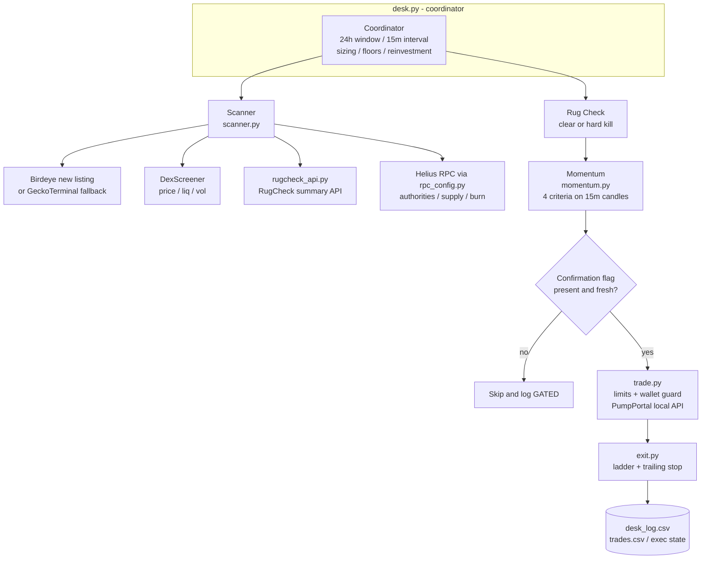

# Solana Meme Desk

A read-only scanner plus confirmation-gated trader for Solana memecoins.

Nothing spends SOL without your explicit "yes" in chat. The desk runs as four agents in sequence — Scanner, Rug Check, Momentum, Exit — coordinated by `desk.py`. Paper mode is the default and spends nothing. Live mode still requires a per-trade confirmation flag that you approve in chat before any signature happens.

## Features

### Scanner (Birdeye, Helius, Flux)
- Discoveries new Solana pools via Birdeye (`/defi/v2/tokens/new_listing`, `meme_platform_enabled=true`) when `BIRDEYE_API_KEY` is set, falling back to GeckoTerminal's free keyless new-pools feed
- On-chain cross-checks via Helius RPC (`getAccountInfo`, `getTokenSupply`, `getTokenAccountsByOwner` on the burn address) for mint and freeze authority state and burned-token evidence
- Flux RPC key support: `FLUX_RPC_URL` key doubles as the RugCheck API key when no dedicated key is set
- DexScreener pricing, liquidity, 24h volume and market cap per token
- Writes a ranked `watchlist.json` sorted by safety score, lowest risk first

### Rug Check (RugCheck API + on-chain authority checks)
- Primary: RugCheck summary API (`GET https://api.rugcheck.xyz/v1/tokens/{mint}/report/summary`) via `rugcheck_api.py`, trying keyless, then `X-API-KEY`, then `api_key` and `key` query modes; the winning mode is recorded per token
- Legacy `/report` endpoint as fallback when the summary call returns nothing
- On-chain authority cross-check against RugCheck: if Helius shows a mint or freeze authority that RugCheck calls revoked (or vice versa), the drift is flagged and scored
- Risk factors include liquidity in USD, mint and freeze authority revoked, Token-2022 dangerous extensions (transfer hook, permanent delegate, pausable, non-transferable), top-holder concentration, RugCheck risks such as LP unlocked, and presence of socials
- Safety score 0-100 (higher = riskier): 0-24 SAFE, 25-44 LOW RISK, 45-64 CAUTION, 65-84 HIGH RISK, 85-100 CRITICAL, UNKNOWN when no routable market exists
- Hard kills in the desk coordinator: active mint authority, active freeze authority, top-10 holders over 30%, LP unlocked, Token-2022 dangerous extensions

### Momentum (15m candles)
- Birdeye primary: `GET /defi/ohlcv` and `GET /defi/history_price` with `type=15m` over a 6-hour window (24 candles), plus a 100-trade Birdeye token-trades pull
- GeckoTerminal OHLCV minute feed aggregated to 15m as fallback, then DexScreener
- All four criteria must pass, and unknown (None) fails closed:
  1. 15m volume rising with price (recent 3 candles vs earlier block)
  2. Higher highs and higher lows (HH/HL structure)
  3. Buy/sell ratio above 1 (volume ratio from Birdeye trades, DexScreener fallback)
  4. New buyers rising (unique buy-side owners recent half vs earlier half, DexScreener 1h proxy as fallback)
- Current slot via Helius RPC for staleness context

### Exit ladder
- Pre-committed ladder: 25% at 2.5x, 25% at 5x, 20% at 10x, remainder (30%) rides the trailing stop
- Trailing stop: moves to breakeven at +65%, then trails 30% below peak and never widens; initial stop is 30% below entry
- State persists in `exit_state.json` so restarts resume cleanly; fills record realized PnL in USD
- `exit.py` is import-only: it never signs or sends anything itself. In paper mode fills are paper records; a live fill still requires the confirmation flag, checked by `trade.py`

### Confirmation gate
- Every live trade needs `confirmations/confirm_<mint>.json` created after you say yes in chat, holding the mint, `sol_amount`, `slippage` and a `yes_at` timestamp
- `trade.py` verifies the flag matches the requested mint, amount and slippage exactly, and that `yes_at` is inside a 5-minute window or it aborts with "YES expired, trade aborts"
- The flag is deleted (consumed) after execution so it cannot be reused
- The desk coordinator in `--mode live` skips any candidate without a flag and logs the skip as `GATED`

### Spend limits
- Max $100 per trade and max $15,000 per day, tracked in `daily_spend.json` with UTC date rollover (resets at 00:00 UTC)
- Sells are exits and skip the limit check; buys are checked before signing and abort on breach

## Architecture



## Quickstart

```bash
pip install requests solders

cp .env.example .env
# edit .env and add your keys (never commit .env)

python3 scanner.py
python3 momentum.py <mint> [pool_addr]
python3 rugcheck_api.py <mint>
python3 rpc_config.py
python3 desk.py --mode paper --once
```

That last line runs one full paper cycle: scan, rug check, momentum, paper open, exit update, everything logged to `desk_log.csv` with zero SOL spent.

## Usage

### scanner.py
```bash
python3 scanner.py
PUMP_SCAN_LIMIT=50 python3 scanner.py
```
Screens the newest `PUMP_SCAN_LIMIT` pools (default 20) and writes `watchlist.json` with `safetyScore`, `verdict`, `flags`, `positives`, mint, pool, price, liquidity, holders and the full RugCheck payload per token. Read-only: no trading, no signing, no key access.

### momentum.py
```bash
python3 momentum.py <mint> [pool_addr]
```
Prints JSON with `passed` (true only when all four criteria are True), the per-criterion detail, candle count and candle source, plus the Birdeye market snapshot (price, FDV, market cap, holders, liquidity). `pool_addr` is optional and only feeds the GeckoTerminal fallback.

### rugcheck_api.py
```bash
python3 rugcheck_api.py <mint>
```
Prints the normalized RugCheck report (score, risks, LP locked percentage, holders, authorities, top holders, Token-2022 extension flags). With no argument it checks USDC as a sanity test.

### rpc_config.py
```bash
python3 rpc_config.py
```
Prints the RPC host, whether Helius is configured, and the current slot. Loads `.env` without requiring python-dotenv.

### desk.py
```bash
python3 desk.py --mode paper --once
python3 desk.py --mode paper --once --limit 20
python3 desk.py --mode paper --hours 24 --interval 900
python3 desk.py --mode live --once
```
- `--mode paper` (default): paper fills only, logged to `desk_log.csv`, `trades_paper.csv` and `paper_state.json`
- `--mode live`: still gated on the confirmation flag per trade; without it the trade is skipped
- `--once`: run one cycle and exit
- `--hours` / `--interval`: run window length (default 24h) and seconds between cycles (default 900, i.e. 15 minutes)
- `--limit`: candidates screened per cycle (default 20)

Coordinator rules: floors of liquidity at least $5,000, holders at least 50, 24h volume at least $10,000. Regular position risks 1.5% of paper capital (starting $500), the larger position risks 5% once per day at most, and size is `risk_amount / stop_pct`, capped at 10% of capital. Realized paper profits are added back to capital.

### trade.py
```bash
python3 trade.py <mint> <sol_amount> <slippage_pct> <buy|sell> [sol_usd_price] [entry_price_usd]
```
Example:
```bash
python3 trade.py <mint> 0.05 10 buy 150.00
```
Only runs if a per-trade confirmation file exists and matches exactly. It loads the keypair (never printed), checks balance via Helius RPC, requests a signed-ready transaction from PumpPortal (`https://pumpportal.fun/api/trade-local`), signs locally, sends via RPC, logs to `trades.csv` and `desk_state_trade_log.json`, and deletes the flag.

## Configuration

Copy `.env.example` to `.env` and fill in your own keys. The file is gitignored; never commit it.

| Variable | Required | Purpose |
| --- | --- | --- |
| `BIRDEYE_API_KEY` | Recommended | Birdeye feed, OHLCV, history price and trades. Without it the scanner falls back to GeckoTerminal and momentum to DexScreener proxies |
| `HELIUS_RPC_URL` | Recommended | Helius RPC for on-chain checks and trade sending; falls back to public mainnet RPC |
| `FLUX_RPC_URL` | Optional | Flux RPC endpoint; its `key` parameter doubles as the RugCheck API key |
| `RUGCHECK_API_KEY` | Optional | Dedicated RugCheck key; wins over the Flux key when both are set |
| `SOLANA_RPC` | Optional | Alternate RPC override; `HELIUS_RPC_URL` wins |
| `SOL_USD_PRICE` | Optional | SOL price used to convert a SOL amount to USD size for the spend limit (default 150.00) |

Environment variables read directly by scripts:

| Variable | Default | Purpose |
| --- | --- | --- |
| `PUMP_SCAN_LIMIT` | 20 | Pools screened per `scanner.py` run |

The trading wallet is expected to be `28K5...aLoy` (`28K5za3Mkt3QopDvZN4TZA8mqnRk2M9wSHUHDkbLaLoy`). `trade.py` refuses to sign with any other keypair. The keypair file itself is never printed or logged.

## Outputs

- `watchlist.json` — ranked scan result, rewritten every scan
- `desk_log.csv` — every agent handoff, decision and paper fill with timestamps
- `trades_paper.csv` — paper fills
- `trades.csv` — every executed trade (created on first trade)
- `paper_state.json`, `coordinator_state.json`, `exit_state.json`, `daily_spend.json`, `desk_state_trade_log.json` — resumable state
- `confirmations/confirm_<mint>.json` — one file per trade, created only after you say yes in chat, consumed after execution

## FAQ

**Is my money at risk by default?**
No. Paper mode is the default and spends nothing. Live mode still needs your yes in chat plus a fresh confirmation flag before anything signs.

**Why did a trade abort?**
The most common reasons: no confirmation flag, the flag's mint/amount/slippage mismatch, the yes is older than 5 minutes, the $100 per-trade or $15,000 daily limit is hit, or the keypair is not the desk wallet.

**What does the score mean?**
0-100, higher is riskier. SAFE up to 24, LOW RISK up to 44, CAUTION up to 64, HIGH RISK up to 84, CRITICAL above that. UNKNOWN means there was no routable market to score.

**What if Birdeye is down or I have no key?**
The scanner falls back to GeckoTerminal's free feed, RugCheck still works keyless (with the Flux key if configured), and momentum falls back to GeckoTerminal OHLCV plus DexScreener. On-chain checks fall back to public RPC.

**Why does the scanner use GeckoTerminal at all?**
Pump.fun's own frontend API returns Cloudflare 403s to plain HTTP clients, so GeckoTerminal (same pool data) is the free discovery feed. Birdeye is used as primary when you have a key.

**Can I change the $100 / $15,000 limits?**
They are constants `MAX_TRADE_USD` and `MAX_DAY_USD` at the top of `trade.py`. Change them deliberately and note the change in the commit.

**What happens on restart?**
Exit positions, paper capital, coordinator state and daily spend all persist to JSON files, so the desk resumes where it left off.

## Risk Disclaimer

This software is informational only and is not financial advice. Solana memecoins are extremely volatile and most go to zero. Scanner scores, momentum checks and rug checks are heuristics, not guarantees: a token can pass every check and still collapse, and a token that fails can still run. Never trade money you cannot afford to lose. You are fully responsible for any trades you approve, for keeping your `.env` and keypair secret, and for understanding what you are signing before you say yes.

## Contributing

See CONTRIBUTING.md.

## License

MIT. See LICENSE.
